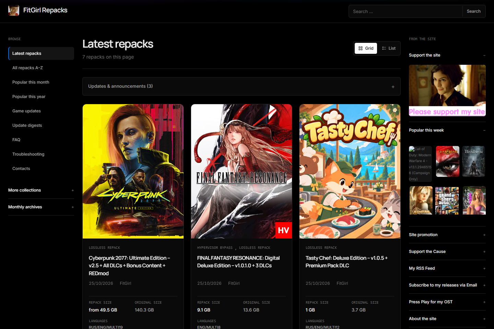
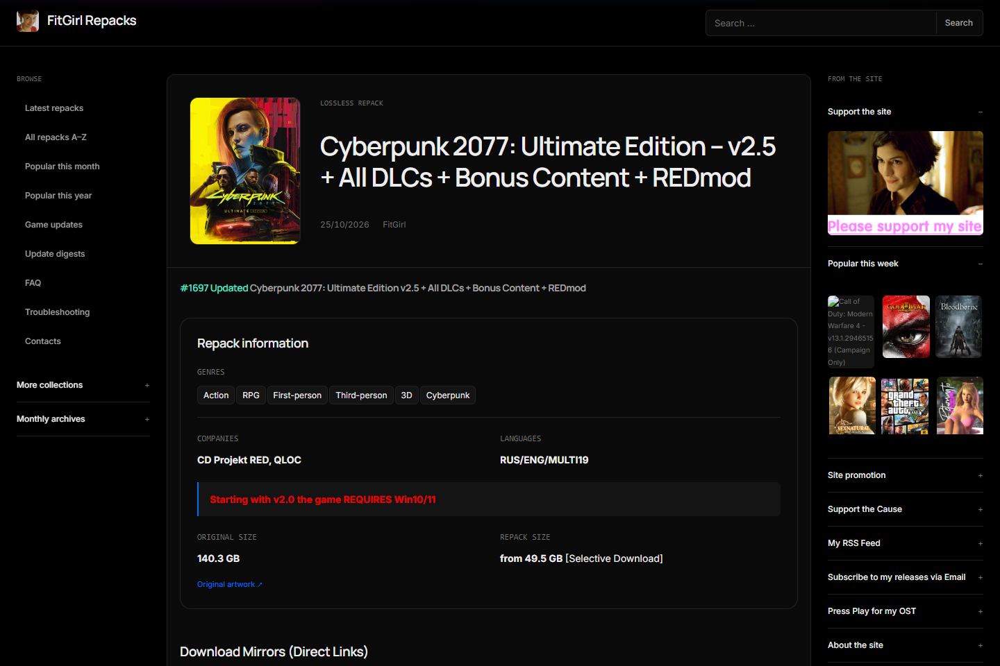
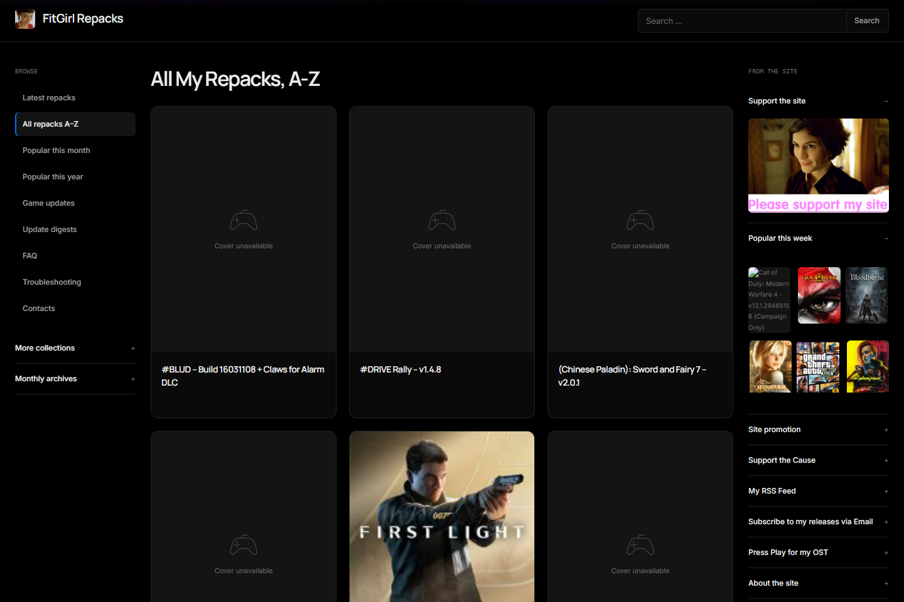

# Pretty FitGirl

[](https://github.com/MuhammedZohaib/pretty-fitgirl/actions/workflows/ci.yml)
[](https://github.com/MuhammedZohaib/pretty-fitgirl/releases)
[](LICENSE)
[](pretty-fitgirl/manifest.json)

> **Pretty FitGirl** is an unofficial, minimal, distraction-free dark theme and user experience enhancement browser extension for [FitGirl Repacks](https://fitgirl-repacks.site/).

Crafted for speed, legibility, and privacy. Zero tracking, zero build steps, and 100% client-side.

---

## 📸 Preview



<details>
<summary>🔍 <strong>More Screenshots (Game Details & A–Z Directory)</strong></summary>

### Game Detail View


### A–Z Directory with Cover Cards


</details>

---

## ✨ Features

- **Minimalist Aesthetic** — Refined charcoal and muted sage color palette designed for high contrast and comfortable browsing.
- **Responsive Cover Cards** — Displays game repacks as clean, consistent cover cards with aligned metadata, sizes, languages, and tags.
- **Smart A–Z Cover Loading** — Converts plain text lists on A–Z directory pages into visual cards with lazy-loaded artwork and local caching.
- **Dual Sidebar Layout** — Quick browsing navigation on the left (categories, archives, digests) and original notices on the right.
- **Self-Hosted Typography** — Bundles Inter and Manrope variable fonts locally. Zero connections to Google Fonts or remote CDNs.
- **Instant Reversibility** — Toggle between Pretty FitGirl and the original website styling at any time via the extension popup.
- **Strictly Private** — Requires only the `storage` permission for local preferences and cache. No background workers, no analytics, no external network requests.

---

## 🚀 Installation

### Option 1: Pre-built Release (Recommended)

1. Download the latest `pretty-fitgirl-vX.Y.Z.zip` from [GitHub Releases](https://github.com/MuhammedZohaib/pretty-fitgirl/releases).
2. Extract the ZIP archive to a folder on your computer.
3. Open your Chromium-based browser (Chrome, Edge, Brave, Opera, Vivaldi):
   - In Chrome / Brave: navigate to `chrome://extensions`
   - In Edge: navigate to `edge://extensions`
4. Turn on **Developer mode** (toggle in the top-right or sidebar).
5. Click **Load unpacked** and select the extracted `pretty-fitgirl` folder (the directory containing `manifest.json`).
6. Navigate to [fitgirl-repacks.site](https://fitgirl-repacks.site/) and enjoy!

### Option 2: From Source

```bash
git clone https://github.com/MuhammedZohaib/pretty-fitgirl.git
cd pretty-fitgirl
```

Load the `pretty-fitgirl` directory directly as an unpacked extension following the instructions above.

---

## ⚙️ Configuration

Click the **Pretty FitGirl** icon in your browser toolbar to customize your experience:

- **Theme Toggle** — Enable or disable the modern theme instantly without reloading.
- **Layout** — Switch between **Cover grid** and **List view**.
- **Density** — Choose between **Comfortable** and **Compact** card spacing.

Preferences are synced across tabs and saved locally in your browser.

---

## 🛠️ Development & Testing

Pretty FitGirl has **zero runtime dependencies** or compilation steps. The source code is pure vanilla JavaScript and modular CSS.

Developer dependencies are only used for QA and automated verification:

```bash
# Install testing tools (Playwright)
npm install

# Run quick manifest & syntax verification
npm run check

# Run full cross-viewport rendering suite (headless Chromium)
npm test

# Build distribution ZIP archives
npm run pack

# Capture fresh README preview screenshots
node scripts/capture-readme-images.cjs
```

---

## 🤝 Contributing

Contributions, bug reports, and suggestions are welcome! Please read [CONTRIBUTING.md](CONTRIBUTING.md) for guidelines on code style, testing, and pull requests.

---

## 📜 Disclaimer

**Pretty FitGirl** is an independent, community-driven open-source project. It is **not** affiliated with, endorsed by, or associated with FitGirl or the FitGirl Repacks website. All trademarks, game titles, artwork, and website content belong to their respective owners.

---

## 📄 License

This project is licensed under the [MIT License](LICENSE).  
Bundled fonts (*Inter* and *Manrope*) are distributed under the [SIL Open Font License](pretty-fitgirl/assets/fonts/Inter-OFL.txt).
